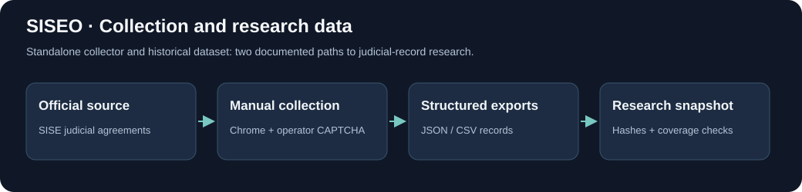

# SISEO Scraper and Judicial Records Dataset

[](https://github.com/EVERYTHINGAICO/siseo-scraper/actions/workflows/tests.yml)



**A research resource from [Everything AI Co](https://www.everythingaico.com/) for collecting and studying Mexican federal judicial agreements.**

SISEO Scraper packages the standalone browser collector and the previously exported judicial-record dataset. Researchers can inspect the data without a Supabase account, a deployed web application, or a running scraper.

## Verified Dataset Snapshot

| Material | Records |
|---|---:|
| Judicial agreements | 159,247 |
| Court-body catalog | 981 |
| Collection-progress records | 2,224 |
| Court bodies represented in agreements | 20 |
| Distinct case-number strings | 8,034 |

Publication dates in the agreements range from **2016-01-29 to 2026-06-30**. These are a historical snapshot, not current or complete national coverage. Case-number strings are not globally unique case identities: use the circuit/court/case combination.

[Download the dataset](https://github.com/EVERYTHINGAICO/siseo-scraper/releases/tag/v0.1-dataset-cice) · [Data dictionary](docs/DATA_DICTIONARY.md) · [Methodology](docs/METHODOLOGY.md) · [Validation](docs/VALIDATION.md)

## Use the Data Without Scraping

Download the three `.csv.gz` files and `SHA256SUMS.txt` from the release. Put the data files in `data/`, then run:

```bash
python scripts/verify_dataset.py data
```

The verifier uses only Python's standard library. It checks the published hashes, CSV headers, record counts, and coverage against the versioned metadata. A minimal reader:

```python
import csv
import gzip

with gzip.open("data/acuerdos.csv.gz", "rt", encoding="utf-8-sig", newline="") as stream:
    for agreement in csv.DictReader(stream):
        # Choose analysis fields deliberately; avoid printing party information by default.
        print(agreement["circuito_id"], agreement["organo_id"], agreement["fecha"])
        break
```

The CSV contains agreement text, not a collection of original court PDFs. The `detalle_url` field preserves a source link where collected. See the [manifest](docs/DATASET_MANIFEST.md) for provenance.

## Run the Collector

Requirements: **Python 3.11+**, a desktop session with Chrome, and the dependencies below. This workflow asks the operator to complete the source portal's CAPTCHA manually.

```bash
python -m venv .venv
# Activate the environment using your shell's activation command.
python -m pip install -r requirements.txt
python scraper.py --help
python scraper.py --circuit 1 --court 726 --date 29/04/2026 --max-records 5
```

The values above are historical examples. Choose a circuit, court option, and date from the current source portal; their availability is not guaranteed. Complete the CAPTCHA in Chrome and press Enter in the terminal when prompted. Output is written under `resultados_sise/` as JSON and CSV.

`--detail-delay` defaults to three seconds of detail visibility. This is not a global rate limiter. `--debug-links` saves diagnostic HTML locally; browser profiles and raw diagnostic outputs must stay outside source control.

## What This Repository Demonstrates

- Browser-driven collection of source records and full agreement text.
- Handling of result rows, detail links/popups, and diagnostic output.
- JSON/CSV exports and a documented historical dataset.
- Institutional keys, coverage tracking, reproducible integrity checks, and explicit limitations.

This is the **standalone manual-CAPTCHA collector**, extracted from the broader SISEO project. It does not reproduce the full historical multi-worker collection pipeline. The original dataset came from that broader pipeline and a PostgreSQL export; it is not claimed to be a fresh run of this standalone script.

## Development Checks

```bash
python -m unittest discover -s tests -v
python scripts/verify_dataset.py data
```

Offline tests cover parsing/export behavior and CLI validation. The published snapshot was independently checked for hashes, headers, row counts, and coverage. A new end-to-end collection against the live portal has **not** been validated in this publication.

## Documentation and Contact

- [Methodology and provenance](docs/METHODOLOGY.md)
- [Data dictionary](docs/DATA_DICTIONARY.md)
- [Validation and limitations](docs/VALIDATION.md)
- [Security and support](SECURITY.md)
- [Ownership and reuse](NOTICE.md)

For technical questions, open an issue with a minimal, redacted reproduction. For company inquiries, visit [Everything AI Co](https://www.everythingaico.com/). Official source terms and third-party rights remain applicable.
